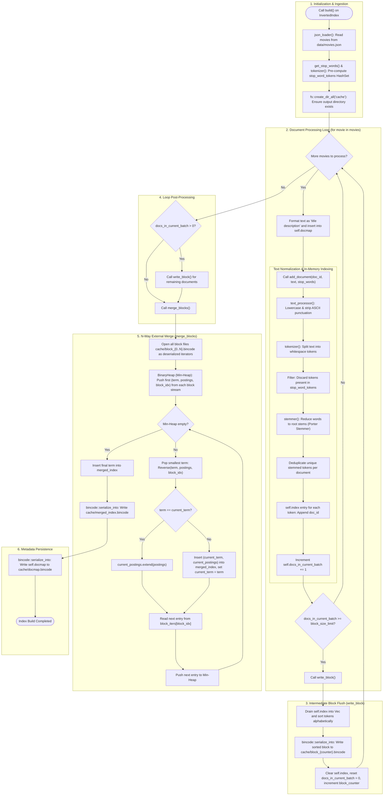

# Building the Inverted Index: Architecture, Implementation, and SPIMI Pipeline

This document details the complete design, implementation, conceptual foundations, syntax fixes, and operational workflow of the **Inverted Index Build Phase** in `rag_in_rust`, implementing the **SPIMI (Single-Pass In-Memory Indexing)** algorithm.

---

## Table of Contents

1. [Overview & Core Concepts](#1-overview--core-concepts)
2. [Syntax Error Analysis in `get_documents`](#2-syntax-error-analysis-in-get_documents)
3. [The InvertedIndex Struct Architecture](#3-the-invertedindex-struct-architecture)
4. [Text Normalization & NLP Pipeline (`add_document`)](#4-text-normalization--nlp-pipeline-add_document)
5. [The `build` Method Implementation](#5-the-build-method-implementation)
6. [Intermediate Block Flushing (`write_block`)](#6-intermediate-block-flushing-write_block)
7. [N-Way External Stream Merge (`merge_blocks`)](#7-n-way-external-stream-merge-merge_blocks)
8. [Document Map Persistence (`docmap`)](#8-document-map-persistence-docmap)
9. [CLI Integration & Execution Commands](#9-cli-integration--execution-commands)
10. [End-to-End Mermaid Architecture Diagram](#10-end-to-end-mermaid-architecture-diagram)

---

## 1. Overview & Core Concepts

An **Inverted Index** is the primary data structure powering full-text search engines. Instead of mapping documents to words (forward index), it maps words (terms/tokens) to the list of document IDs in which they appear (posting lists).

### Why SPIMI (Single-Pass In-Memory Indexing)?
When indexing large text collections:
- Keeping the entire vocabulary and all posting lists in memory (`HashMap<String, Vec<u32>>`) will quickly exceed available RAM.
- Traditional index construction methods (such as MapReduce or sorting all token-doc pairs globally) require massive external temporary storage and extensive disk I/O.
- **SPIMI** solves this by:
  1. Processing documents directly into an in-memory dictionary.
  2. Flushing sorted intermediate runs (blocks) to disk whenever memory reaches a threshold (`block_size_limit`).
  3. Reclaiming RAM after each flush.
  4. Performing a multi-way external stream merge (**N-way merge**) over the sorted block files once all documents have been processed.

---

## 2. Syntax Error Analysis in `get_documents`

In [`src/inverted_index.rs`](file:///c:/My_Files/rag_in_rust/src/inverted_index.rs#L222), line 222 contained the following signature:

```rust
pub fn get_documents(&self, term: &str) -> Option<<&Vec<u32>>> {
```

### The Root Cause
1. **Duplicate Angle Brackets (`<< ... >>>`)**:
   Rust generic type arguments are enclosed by a single pair of angle brackets (`Option<T>`). In this line, there were two opening brackets and three closing brackets:
   - `Option<` opens the type constructor.
   - `<&Vec<u32>>` starts with an extraneous `<`.
   - In Rust grammar, `<` inside type arguments is parsed as a qualified path syntax (e.g., `<Type as Trait>::Item`). Placing `<&Vec<u32>>` without a valid path expression causes the Rust compiler to emit an unexpected token / syntax error.

2. **Correct Return Type**:
   Because `self.index` is a `HashMap<String, Vec<u32>>`, calling `self.index.get(term)` looks up a `&str` key and returns a reference to the stored value: `Option<&Vec<u32>>`.

### The Corrected Code

```rust
pub fn get_documents(&self, term: &str) -> Option<&Vec<u32>> {
    self.index.get(term)
}
```

---

## 3. The `InvertedIndex` Struct Architecture

Defined in [`src/inverted_index.rs`](file:///c:/My_Files/rag_in_rust/src/inverted_index.rs#L15):

```rust
pub struct InvertedIndex {
    pub index: HashMap<String, Vec<u32>>, // In-memory posting lists: token -> [doc_id, ...]
    pub docmap: HashMap<u32, Movie>,      // In-memory document lookup: doc_id -> Movie metadata
    pub block_size_limit: usize,          // Threshold: documents processed before flushing to disk
    pub block_counter: u32,               // Total intermediate blocks written to disk
    pub docs_in_current_batch: usize,     // Document counter for the active in-memory batch
}
```

### State Management
- `index`: Holds the active working dictionary in RAM. Cleared every time a block is written to disk.
- `docmap`: Holds full [`Movie`](file:///c:/My_Files/rag_in_rust/src/data_loader.rs#L14) records so search queries can return rich metadata in $O(1)$ without re-reading the original JSON file.
- `block_size_limit`: Configures how many documents reside in RAM before triggering [`write_block`](file:///c:/My_Files/rag_in_rust/src/inverted_index.rs#L78).
- `block_counter`: Incremented each time a block is flushed; used to name intermediate files: `cache/block_{counter}.bincode`.

---

## 4. Text Normalization & NLP Pipeline (`add_document`)

When [`add_document`](file:///c:/My_Files/rag_in_rust/src/inverted_index.rs#L27) is called, each document's text is transformed into indexed tokens through four deterministic stages that must mirror query-time processing:

```
Raw Text (title + description)
   │
   ▼
1. text_processor(&text)       -> Lowercase + strip ASCII punctuation
   │
   ▼
2. tokenizer(&cleaned_text)    -> Split on whitespace into HashSet<&str> tokens
   │
   ▼
3. Stop Word Filtering         -> Discard tokens present in stop_word_tokens HashSet
   │
   ▼
4. stemmer(&filtered_tokens)   -> Reduce words to morphological roots (Porter Stemmer)
   │
   ▼
5. Deduplication per Doc       -> Ensure doc_id is appended at most once per token
   │
   ▼
6. HashMap Insertion           -> self.index.entry(stem).or_default().push(doc_id)
```

### Document-Level Deduplication
If a term appears multiple times in a single movie (e.g., "star", "wars", "star"), deduplicating tokens before posting list insertion prevents duplicate `doc_id` entries in `Vec<u32>`.

### Memory Threshold Check
After appending tokens, [`add_document`](file:///c:/My_Files/rag_in_rust/src/inverted_index.rs#L27) increments `self.docs_in_current_batch`. If `docs_in_current_batch >= block_size_limit`, [`write_block`](file:///c:/My_Files/rag_in_rust/src/inverted_index.rs#L78) is invoked automatically.

---

## 5. The `build` Method Implementation

[`build`](file:///c:/My_Files/rag_in_rust/src/inverted_index.rs#L237) orchestrates the entire offline indexing phase.

### Bug in Original Commented Draft
In the original draft of [`src/inverted_index.rs`](file:///c:/My_Files/rag_in_rust/src/inverted_index.rs#L254-L260), steps 3, 4, and 5 were placed inside the body of the `for movie in &movies` loop. This would cause the engine to repeatedly flush blocks, merge, and save docmaps on every iteration. They must be placed **outside** the loop.

### Complete Implementation

```rust
pub fn build(&mut self) {
    // 1. Call `json_loader()` to load all movies from `data/movies.json`
    let movies: Vec<Movie> = json_loader().expect("Failed to load movies from JSON!");

    // Stop words are preloaded and tokenized once upfront to avoid recomputing per document
    let stop_words: String = get_stop_words();
    let stop_word_tokens: HashSet<&str> = tokenizer(&stop_words);

    // Ensure output cache directory exists
    fs::create_dir_all("cache").expect("Failed to create cache directory");

    // 2. Iterate through each movie:
    for movie in movies {
        // Format text as "{title} {description}" with space to avoid merging words
        let title_description = format!("{} {}", movie.title, movie.description);
        let doc_id = movie.id;

        // Pass doc_id and formatted text through the NLP and indexing pipeline
        self.add_document(doc_id, &title_description, &stop_word_tokens);

        // Store document in docmap (id -> Movie metadata)
        self.docmap.insert(doc_id, movie);
    }

    // 3. Once the loop finishes, flush any remaining in-memory documents in the final block
    if self.docs_in_current_batch > 0 {
        self.write_block();
    }

    // 4. Merge all generated block files into cache/merged_index.bincode via N-way merge
    self.merge_blocks();

    // 5. Serialize and save self.docmap to cache/docmap.bincode
    let docmap_file = File::create("cache/docmap.bincode")
        .expect("Failed to create docmap file");
    let writer = BufWriter::new(docmap_file);
    bincode::serialize_into(writer, &self.docmap)
        .expect("Failed to serialize docmap");

    println!(
        "Index build complete! Processed {} documents across {} blocks.",
        self.docmap.len(),
        self.block_counter
    );
}
```

### Serialization Prerequisite
For `bincode::serialize_into` to serialize `self.docmap: HashMap<u32, Movie>`, [`Movie`](file:///c:/My_Files/rag_in_rust/src/data_loader.rs#L14) in [`src/data_loader.rs`](file:///c:/My_Files/rag_in_rust/src/data_loader.rs) must derive `Serialize`:

```rust
#[derive(serde::Serialize, serde::Deserialize)]
pub struct Movie {
    pub id: u32,
    pub title: String,
    pub description: String,
}
```

---

## 6. Intermediate Block Flushing (`write_block`)

When RAM reaches the document limit, [`write_block`](file:///c:/My_Files/rag_in_rust/src/inverted_index.rs#L78) flushes the active batch:

1. **Draining and Sorting**:
   ```rust
   let mut sorted_entries: Vec<(String, Vec<u32>)> = self.index.drain().collect();
   sorted_entries.sort_by(|(token_a, _), (token_b, _)| token_a.cmp(&token_b));
   ```
   Lexicographical sorting of keys is the essential SPIMI requirement that permits $O(1)$-memory stream merging in step 7.
2. **Binary Serialization**:
   Serializes `sorted_entries` using `bincode::serialize_into` to `cache/block_{self.block_counter}.bincode`.
3. **State Reset**:
   Clears `self.index`, resets `self.docs_in_current_batch = 0`, and increments `self.block_counter += 1`.

---

## 7. N-Way External Stream Merge (`merge_blocks`)

[`merge_blocks`](file:///c:/My_Files/rag_in_rust/src/inverted_index.rs#L114) performs an N-way external stream merge across all intermediate block files:

1. **Stream Iterators**:
   Opens `cache/block_{0..N}.bincode` files and constructs an iterator over each block's sorted entries:
   ```rust
   let mut block_iters: Vec<std::vec::IntoIter<(String, Vec<u32>)>> = Vec::new();
   ```

2. **Min-Heap (Priority Queue)**:
   Rust's `BinaryHeap` is a max-heap by default. Wrapping entries in `std::cmp::Reverse` converts it into a min-heap:
   ```rust
   let mut min_heap: BinaryHeap<Reverse<(String, Vec<u32>, usize)>> = BinaryHeap::new();
   ```
   Each heap item is: `Reverse((term, posting_list, block_index))`.

3. **Seeding the Heap**:
   Reads the smallest term from each block iterator and pushes it onto the heap.

4. **Merge & Concatenation Loop**:
   - The smallest term across all active blocks is popped from the heap.
   - If the popped term matches `current_term`, its posting list is concatenated:
     ```rust
     current_postings.extend(postings);
     ```
     Because blocks were processed sequentially, document IDs remain naturally sorted in ascending order.
   - If a new term is encountered, the previous `(current_term, current_postings)` pair is inserted into `merged_index`, and tracking begins for the new term.
   - The iterator corresponding to `block_index` yields its next entry, which is pushed back to the heap.

5. **Final Index Persistence**:
   The completed dictionary is written to `cache/merged_index.bincode` using `BufWriter` and `bincode::serialize_into`.

---

## 8. Document Map Persistence (`docmap`)

The document map is a secondary data structure mapping:
$$\text{doc\_id} \to \text{Movie}$$

### Why `docmap.bincode` is Needed
- An inverted index only tells search which `doc_id` values match a query.
- Users want to view movie titles and descriptions, not raw numerical IDs.
- Storing `docmap` as a serialized binary hashmap allows the search engine to load it during startup via [`load_from_cache`](file:///c:/My_Files/rag_in_rust/src/inverted_index.rs#L199) and fetch full movie metadata in $O(1)$ without reparsing `data/movies.json`.

---

## 9. CLI Integration & Execution Commands

### A. Updating [`src/main.rs`](file:///c:/My_Files/rag_in_rust/src/main.rs)

1. Add the `Build` variant to `enum Commands`:
   ```rust
   #[derive(Subcommand)]
   enum Commands {
       /// Build and save the inverted index and docmap
       Build,

       /// Search movies using keyword
       Search {
           #[arg(help = "Search query")]
           query: String,
       },
   }
   ```

2. Add the execution handler in `main()`:
   ```rust
   match &cli.command {
       Commands::Build => {
           println!("Building inverted index...");
           let mut index = inverted_index::InvertedIndex {
               index: std::collections::HashMap::new(),
               docmap: std::collections::HashMap::new(),
               block_size_limit: 500, // Flush to disk every 500 documents
               block_counter: 0,
               docs_in_current_batch: 0,
           };
           index.build();
       }
       Commands::Search { query } => {
           // Search execution
       }
   }
   ```

### B. Terminal Commands

1. **Build the Index**:
   ```powershell
   cargo run -- build
   ```
   Generates `cache/block_*.bincode`, `cache/merged_index.bincode`, and `cache/docmap.bincode`.

2. **Run Keyword Search**:
   ```powershell
   cargo run -- search "merida"
   ```

3. **Verification Assertion**:
   Searching for token `"merida"` must return document ID `4651` corresponding to the movie *"Brave"*.

---

## 10. End-to-End Mermaid Architecture Diagram

The flowchart below traces the complete lifecycle of the build phase from JSON parsing to disk serialization:


