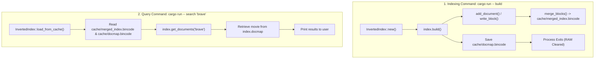

# Search Phase Methods, Architecture, and In-Memory vs. Disk Retrieval

This document provides a comprehensive, structured reference for all concepts, architectural decisions, and code implementations related to the **Search Phase** of the Inverted Index in `rag_in_rust`, specifically focusing on `load_from_cache`, `get_documents`, and the mechanics of querying an index built via SPIMI (Single-Pass In-Memory Indexing).

---

## Table of Contents
1. [The Conceptual Paradox: Indexing Memory vs. Query Memory](#1-the-conceptual-paradox-indexing-memory-vs-query-memory)
2. [OOM Risks and How Production Engines Solve Them](#2-oom-risks-and-how-production-engines-solve-them)
   - [Why SPIMI Block Flushing Still Matters](#why-spimi-block-flushing-still-matters)
   - [The Monolithic Deserialization Flaw](#the-monolithic-deserialization-flaw)
   - [The Production Solution: Term Dictionary (Lexicon) + Disk Seeks](#the-production-solution-term-dictionary-lexicon--disk-seeks)
   - [The Modern Alternative: Memory Mapping (`mmap`)](#the-modern-alternative-memory-mapping-mmap)
3. [Decision Matrix: In-Memory `bincode` vs. Tantivy](#3-decision-matrix-in-memory-bincode-vs-tantivy)
   - [How Tantivy Works Under the Hood](#how-tantivy-works-under-the-hood)
   - [Dataset Size Thresholds](#dataset-size-thresholds)
   - [The "RAM Inflation Ratio" in Rust](#the-ram-inflation-ratio-in-rust)
   - [Feature Triggers Beyond Raw Size](#feature-triggers-beyond-raw-size)
4. [Program Architecture and Process Lifecycle](#4-program-architecture-and-process-lifecycle)
   - [Where and When Methods Are Called](#where-and-when-methods-are-called)
   - [Process Isolation: Why We Cannot Reuse the Indexing Struct](#process-isolation-why-we-cannot-reuse-the-indexing-struct)
   - [Why `load_from_cache` Returns `Self` (Constructor Pattern)](#why-load_from_cache-returns-self-constructor-pattern)
5. [Code Implementation and Walkthrough](#5-code-implementation-and-walkthrough)
   - [Implementation of `load_from_cache`](#implementation-of-load_from_cache)
   - [Implementation of `get_documents`](#implementation-of-get_documents)
   - [Variable-by-Variable State Walkthrough](#variable-by-variable-state-walkthrough)
6. [End-to-End Query Execution Pipeline](#6-end-to-end-query-execution-pipeline)
   - [Chronological Execution Flow](#chronological-execution-flow)
   - [Postings Intersection (AND) and Union (OR)](#postings-intersection-and-and-union-or)
   - [Document Hydration via `docmap`](#document-hydration-via-docmap)
7. [Important Prerequisites and Warnings](#7-important-prerequisites-and-warnings)

---

## 1. The Conceptual Paradox: Indexing Memory vs. Query Memory

### The Question:
> *"We flushed `self.index` to disk block-by-block during indexing to keep RAM usage low. Now in `get_documents`, if we deserialize the entire merged index back into memory, isn't that counterintuitive? What was the point of flushing in the first place?"*

### The Answer:
In Information Retrieval (IR), there is a fundamental distinction between the **Indexing Phase** (writing) and the **Query Phase** (reading):

| Metric / Concern | Indexing Phase (`build`) | Query Phase (`search`) |
| :--- | :--- | :--- |
| **Workload** | Write-heavy, CPU-intensive parsing, dynamic heap allocation. | Read-only random lookups. |
| **Memory Churn** | **Extreme.** Ingesting raw JSON trees, temporary token lists, string buffers, and dynamically resizing `HashMap` buckets simultaneously. | **Static and Compact.** Only the normalized vocabulary keys mapped to sorted `u32` doc IDs. |
| **Primary Goal** | **Prevent Out-Of-Memory (OOM) crashes** while processing unbounded corpora. | **Sub-millisecond query response time** ($O(1)$ lookups). |

### The Fatal Trap to Avoid:
Deserializing `cache/merged_index.bincode` **inside** `get_documents(&self, term: &str)` on every call is an anti-pattern:
```rust
// ❌ ANTI-PATTERN: DO NOT DESERIALIZE INSIDE get_documents!
pub fn get_documents(&self, term: &str) -> Vec<u32> {
    let file = File::open("cache/merged_index.bincode").unwrap();
    let index: HashMap<String, Vec<u32>> = bincode::deserialize_from(file).unwrap();
    index.get(term).cloned().unwrap_or_default()
}
```
If a user searches for a 3-word query (`"brave scottish princess"`), `get_documents` would be invoked 3 times. The program would read and deserialize the multi-megabyte file from disk 3 separate times for a single search, making it thousands of times slower than a brute-force linear scan.

---

## 2. OOM Risks and How Production Engines Solve Them

### Why SPIMI Block Flushing Still Matters
Even if the final merged index is loaded into RAM, flushing blocks during `build()` was essential:
* Peak memory during indexing is typically **5x to 10x larger** than the final index size.
* To index 10 GB of text, unmanaged indexing might allocate 50 GB of temporary heap memory.
* SPIMI guarantees that **index creation can succeed on a low-RAM machine** (e.g. 2 GB RAM) over a 100 GB dataset by processing in fixed-size blocks.

### The Monolithic Deserialization Flaw
If your dataset is genuinely large (e.g., 50 GB of text), deserializing the entire `merged_index.bincode` into a `HashMap` inside `load_from_cache()` **will cause an immediate OOM crash**.

Loading the whole index into RAM via `bincode` is an educational stepping stone suitable for small-to-medium datasets.

### The Production Solution: Term Dictionary (Lexicon) + Disk Seeks
In production search engines (e.g., Apache Lucene, Tantivy, SQLite FTS), the index is **never** loaded as one monolithic in-memory map. Instead, the on-disk index is split into two structures:

```
+--------------------------------------------------------------------------+
|  1. Term Dictionary / Lexicon (Kept in RAM or compressed in an FST)     |
|     term: "apple"   -->  offset: 0,       length: 12 bytes               |
|     term: "brave"   -->  offset: 12,      length: 8 bytes                |
|     term: "cat"     -->  offset: 20,      length: 4 bytes                |
+--------------------------------------------------------------------------+
|  2. Postings File (Stays strictly on DISK)                               |
|     Byte  0..11:  [Doc 1, Doc 5, Doc 9]   (postings for "apple")          |
|     Byte 12..19:  [Doc 4651, Doc 8900]    (postings for "brave")          |
|     Byte 20..23:  [Doc 3]                 (postings for "cat")            |
+--------------------------------------------------------------------------+
```

#### How True Disk-Based `get_documents` Operates:
```rust
use std::fs::File;
use std::io::{Read, Seek, SeekFrom};
use std::collections::HashMap;

pub struct DiskInvertedIndex {
    // Only the offsets are in RAM (few megabytes for millions of words)
    pub term_offsets: HashMap<String, (u64, usize)>,
    pub postings_file: File,
}

impl DiskInvertedIndex {
    pub fn get_documents(&mut self, term: &str) -> Option<Vec<u32>> {
        // 1. Look up file coordinates in RAM: O(1)
        let &(offset, length) = self.term_offsets.get(term)?;

        // 2. Jump directly to that byte offset on disk without reading the whole file
        self.postings_file.seek(SeekFrom::Start(offset)).ok()?;

        // 3. Read ONLY this term's bytes (e.g. 8 bytes for 2 doc IDs)
        let mut buffer = vec![0u8; length];
        self.postings_file.read_exact(&mut buffer).ok()?;

        // 4. Decode just this term's posting list
        let postings: Vec<u32> = bincode::deserialize(&buffer).ok()?;
        Some(postings)
    }
}
```
* **RAM Consumed by Search:** A few bytes per query, regardless of whether the file on disk is 50 MB or 500 GB.

### The Modern Alternative: Memory Mapping (`mmap`)
Libraries like Tantivy use `mmap`:
```rust
let mmap = unsafe { memmap2::Mmap::map(&file)? };
```
* The file is mapped directly into the virtual address space of the process.
* **No data is loaded into RAM upfront.**
* When code accesses bytes for `"brave"`, the OS kernel hardware-faults **only the specific 4 KB disk page** containing those bytes into the CPU cache.
* When RAM is needed elsewhere, the OS automatically evicts the clean page without writing to disk.

---

## 3. Decision Matrix: In-Memory `bincode` vs. Tantivy

### How Tantivy Works Under the Hood
Tantivy is a high-performance, on-disk search engine library for Rust inspired by Apache Lucene:
1. **On-Disk Segment Architecture:** Documents are stored in immutable segments using an LSM-tree-like structure.
2. **FST (Finite State Transducer) Lexicon:** Compresses millions of dictionary words into a deterministic finite-state automaton that resides in minimal RAM.
3. **SIMD & Bit-Packing Compression:** Compresses sorted integers (doc IDs) down to 1–2 bits per ID instead of full 32-bit (`u32`) integers.
4. **`mmap` Direct Access:** All segment reads go through OS memory-mapped files.

### Dataset Size Thresholds

| Tier | Dataset Size (Docs / Raw Text) | Recommended Architecture | Rationale |
| :--- | :--- | :--- | :--- |
| **Small** | **< 50,000 docs**<br>(< 50–100 MB text)<br>*e.g. movie dataset* | **In-Memory `bincode` / `HashMap`** | Fits easily in RAM. Deserialization takes < 50 ms. Zero external dependencies. Complete code control. |
| **Medium** | **50,000 – 500,000 docs**<br>(100 MB – 1 GB text) | **Transition Zone** | Fits in 16–32 GB RAM, but CLI startup latency suffers (1–3 seconds to deserialize per search). High RAM inflation. |
| **Large** | **> 500,000 docs**<br>(> 1 GB text to Terabytes) | **Tantivy** | In-memory `HashMap` is unfeasible. Requires on-disk seeking, `mmap`, and compressed postings. |

### The "RAM Inflation Ratio" in Rust
A 200 MB `bincode` file on disk often expands to **800 MB – 1.2 GB of active RAM** once deserialized into `HashMap<String, Vec<u32>>`:
* Each `String` key: 24 bytes stack metadata (`ptr`, `cap`, `len`) + separate heap string buffer + allocator alignment padding.
* Each `Vec<u32>` value: 24 bytes stack metadata + separate heap array buffer + allocation padding.
* `HashMap` internals: Maintains 1 byte control metadata per bucket, plus empty buckets to keep load factor $< 87.5\%$.
* Allocator fragmentation: Creating hundreds of thousands of independent heap objects fragments virtual memory.

### Feature Triggers Beyond Raw Size
Choose Tantivy even for smaller datasets if you require:
1. **Instant CLI Startup:** `mmap` starts in 0.001 seconds; `bincode` requires waiting for full file deserialization.
2. **Relevance Scoring:** BM25 / TF-IDF ranking (ranking by term importance and frequency rather than binary boolean match).
3. **Incremental Updates:** Appending new documents without rebuilding the entire index from scratch.
4. **Rich Query Support:** Fuzzy search (Levenshtein distance), phrase queries (`"the dark knight"` in order), and faceted filters.

---

## 4. Program Architecture and Process Lifecycle

### Where and When Methods Are Called



* **`build()` is called in `Commands::Build`:** It acts as the offline index compiler. Once the files are written to disk, its job is finished and the program terminates.
* **`load_from_cache()` is called in `Commands::Search`:** It runs whenever a user performs a search. It loads the compiled index from disk to serve the query.
* **`load_from_cache()` is NEVER called inside `build()`:** Doing so would be like packing a suitcase, closing it, immediately unpacking it, and exiting the house empty-handed.

### Process Isolation: Why We Cannot Reuse the Indexing Struct
The `build` and `search` subcommands are run at different times as **two separate OS processes**:
1. When `cargo run -- build` finishes, the operating system **terminates the process and reclaims 100% of its RAM**.
2. When `cargo run -- search "brave"` runs, it is a **brand-new process** with a blank memory space. The struct from `build` does not exist in memory. The only bridge between the two runs is the persistent files on disk in `cache/`.
3. Even within a hypothetical continuous process, `write_block()` called `self.index.clear()`, leaving the indexing struct's in-memory map empty at the end of `build()`.

### Why `load_from_cache` Returns `Self` (Constructor Pattern)
In Rust, constructors that load an object from persistent storage are written as associated functions returning `Self` or `Result<Self, Error>` (similar to `File::open` or `String::from`):

```rust
// ✅ Idiomatic Rust: Clean factory constructor
let index = InvertedIndex::load_from_cache()?;
```

If `load_from_cache` took `&mut self` instead:
```rust
// ❌ Anti-pattern: Requires initializing a dummy struct with useless data first
let mut index = InvertedIndex {
    index: HashMap::new(),
    docmap: HashMap::new(),
    block_size_limit: 0,
    block_counter: 0,
    docs_in_current_batch: 0,
};
index.load_from_cache()?; // Overwrites the dummy fields
```

---

## 5. Code Implementation and Walkthrough

### Implementation of `load_from_cache`

```rust
// In src/inverted_index.rs

impl InvertedIndex {
    /// Deserializes the finalized inverted index and docmap from disk (cache/ directory)
    /// and reconstructs the InvertedIndex struct in memory for fast querying.
    /// Called once at the beginning of the `Search` command in `src/main.rs`.
    pub fn load_from_cache() -> Result<Self, Box<dyn std::error::Error>> {
        // 1. Open the finalized merged inverted index file from `cache/merged_index.bincode`.
        let index_file = File::open("cache/merged_index.bincode")?;
        let index_reader = BufReader::new(index_file);
        
        // 2. Deserialize the binary payload directly into the in-memory HashMap.
        let index: HashMap<String, Vec<u32>> = bincode::deserialize_from(index_reader)?;

        // 3. Open the serialized docmap file from `cache/docmap.bincode`.
        let docmap_file = File::open("cache/docmap.bincode")?;
        let docmap_reader = BufReader::new(docmap_file);
        
        // 4. Deserialize the binary payload into the docmap (doc_id -> Movie).
        let docmap: HashMap<u32, Movie> = bincode::deserialize_from(docmap_reader)?;

        // 5. Construct and return the initialized InvertedIndex struct ready for search queries.
        //    Batch and block counters are set to 0 since indexing is already complete.
        Ok(Self {
            index,
            docmap,
            block_size_limit: 0,
            block_counter: 0,
            docs_in_current_batch: 0,
        })
    }
}
```

### Implementation of `get_documents`

```rust
// In src/inverted_index.rs

impl InvertedIndex {
    /// Looks up a preprocessed query term in the finalized inverted index.
    /// Returns a borrowed reference to the sorted list of document IDs (posting list),
    /// or None if the term does not exist in the vocabulary.
    pub fn get_documents(&self, term: &str) -> Option<&Vec<u32>> {
        // 1. Look up `term` in the loaded in-memory index dictionary (self.index).
        //    (The index was already loaded into memory via `load_from_cache()`).
        //
        // 2. Query `term` in the index dictionary to get its posting list.
        //    Because `self.index` is a `HashMap<String, Vec<u32>>`, `.get(term)`
        //    performs an O(1) hash lookup comparing the &str slice to the String keys.
        //
        // 3. Return the associated posting list (borrowed &Vec<u32> of sorted doc_ids),
        //    or None if the term does not exist in the vocabulary.
        self.index.get(term)
    }
}
```

> **Design Choice: Borrowed vs. Owned**
> * Returning `Option<&Vec<u32>>` (or `Option<&[u32]>`) requires **0 allocations**.
> * If an owned vector with empty fallback is preferred by the caller:
>   ```rust
>   pub fn get_documents(&self, term: &str) -> Vec<u32> {
>       self.index.get(term).cloned().unwrap_or_default()
>   }
>   ```

### Variable-by-Variable State Walkthrough

Suppose the search query is `"brave"`:

1. **`term: &str`**:
   - Value: `"brave"` (borrowed string slice after cleaning, tokenizing, and stemming).
2. **`self.index: HashMap<String, Vec<u32>>`**:
   - Value: Pre-loaded vocabulary map. Contains entry `"brave" => vec![4651, 8900]`.
3. **`self.index.get(term)`**:
   - Action: Hashes `"brave"`, locates bucket, compares strings.
   - Result: Returns `Some(&vec![4651, 8900])`.
4. **Memory Allocation**:
   - **0 bytes allocated**. No new strings, vectors, or disk reads occur during this call.

---

## 6. End-to-End Query Execution Pipeline

### Chronological Execution Flow

#### Step 1: User Input
```bash
cargo run -- search "brave adventure"
```

#### Step 2: Index Loading in `main.rs`
```rust
Commands::Search { query } => {
    let index = InvertedIndex::load_from_cache()
        .expect("Index not found! Please run 'cargo run -- build' first.");
    ...
```
* If the user never ran `build`, `load_from_cache()` fails cleanly with `Err(NotFound)`.

#### Step 3: Query Normalization Pipeline
The query string must pass through the **exact same NLP pipeline** used during document indexing:
1. `text_processor(query)` $\rightarrow$ Strip punctuation, lowercase.
2. `tokenizer(&cleaned_query)` $\rightarrow$ Split by whitespace into tokens.
3. Stop-word removal $\rightarrow$ Drop words like `"in"`, `"the"`, `"and"`.
4. `stemmer(&tokens)` $\rightarrow$ Stem tokens into root forms: `["brave", "adventur"]`.

#### Step 4: Term Retrieval via `get_documents`
```rust
let postings_brave = index.get_documents("brave");     // e.g. Some(&[4651, 8900])
let postings_adventur = index.get_documents("adventur"); // e.g. Some(&[102, 4651, 5500])
```

#### Step 5: Postings Intersection (AND) and Union (OR)
Because posting lists are sorted in ascending order of document IDs, set operations are efficient:

##### Two-Pointer Intersection (AND query):
```rust
fn intersect(p1: &[u32], p2: &[u32]) -> Vec<u32> {
    let mut result = Vec::new();
    let (mut i, mut j) = (0, 0);

    while i < p1.len() && j < p2.len() {
        if p1[i] == p2[j] {
            result.push(p1[i]);
            i += 1;
            j += 1;
        } else if p1[i] < p2[j] {
            i += 1;
        } else {
            j += 1;
        }
    }
    result
}
```
* Time Complexity: $O(L_1 + L_2)$, where $L_1$ and $L_2$ are lengths of the posting lists.
* Result for `[4651, 8900]` $\cap$ `[102, 4651, 5500]` = `vec![4651]`.

#### Step 6: Document Hydration via `docmap`
For each matching document ID (`4651`):
```rust
if let Some(movie) = index.docmap.get(&4651) {
    println!("{}", movie);
}
```
* Retrieves the full `Movie` metadata directly from memory without consulting `movies.json`.

---

## 7. Important Prerequisites and Warnings

### 1. `Movie` Struct Serialization
For `docmap` to be serialized and deserialized via `bincode`, [`Movie`](file:///c:/My_Files/rag_in_rust/src/data_loader.rs#L13-L19) in `src/data_loader.rs` must derive **both** `Serialize` and `Deserialize`:
```rust
use serde::{Deserialize, Serialize};

#[derive(Serialize, Deserialize, Debug)]
pub struct Movie {
    pub id: u32,
    pub title: String,
    pub description: String,
}
```

### 2. Synchronization of Text Normalization
The search pipeline in `main.rs` must use the exact same cleaning, tokenizing, stop-word filtering, and stemming pipeline as `add_document` in `inverted_index.rs`. If queries are stemmed differently than indexed text (e.g. searching `"running"` without stemming to `"run"`), terms will fail to match in `self.index`.
